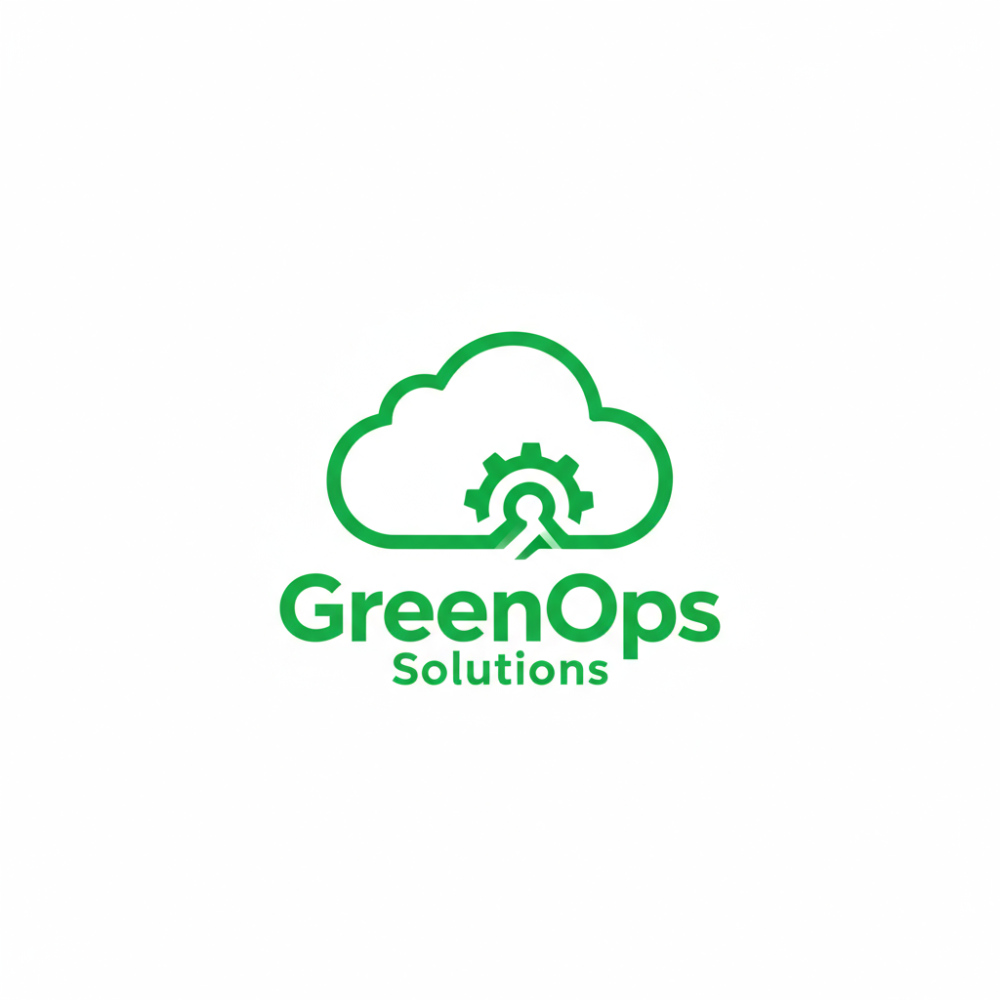
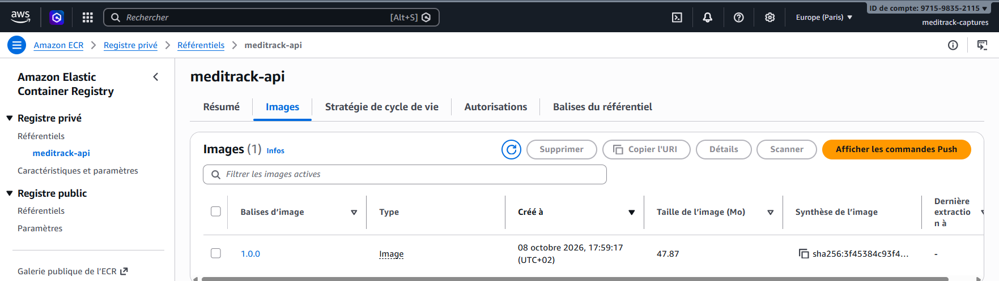
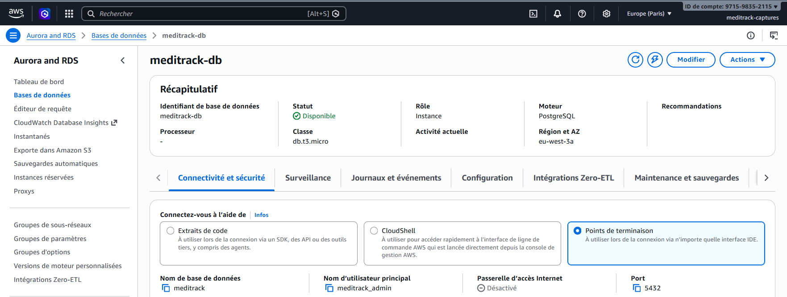
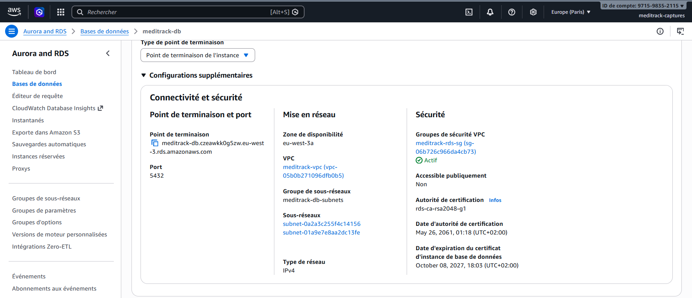
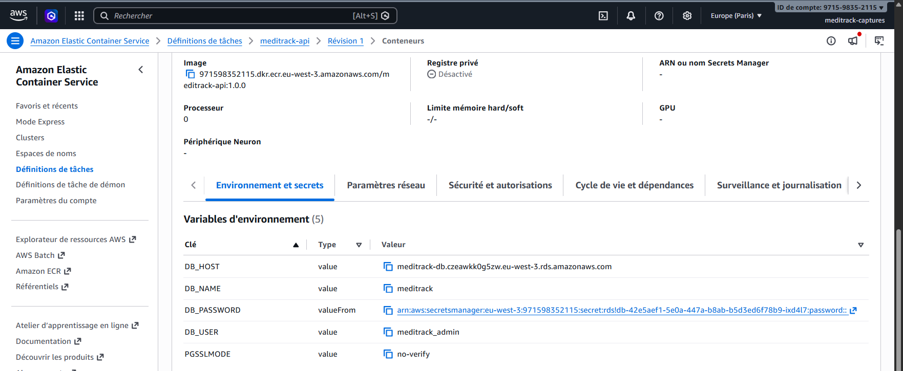
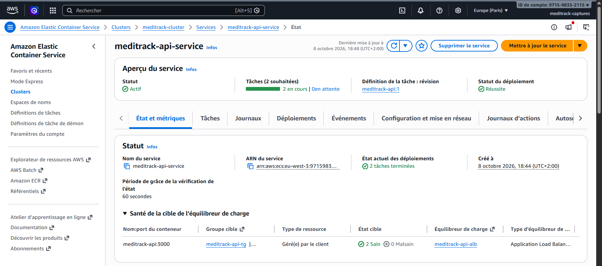
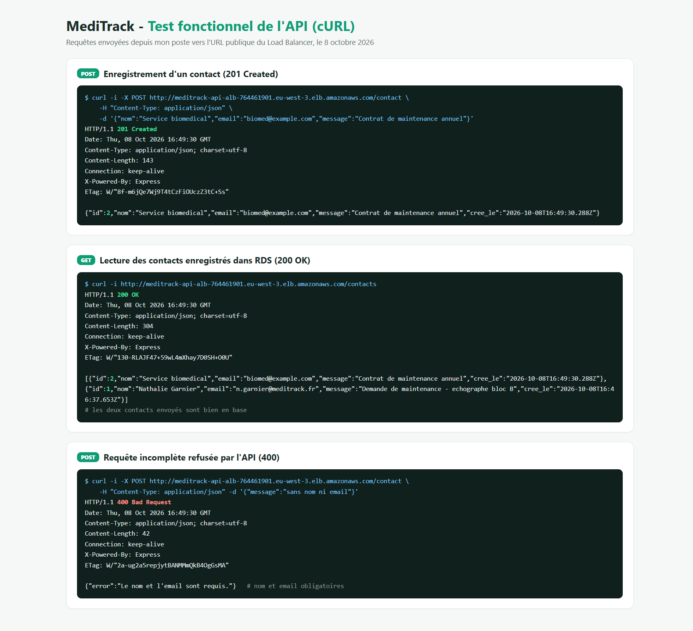
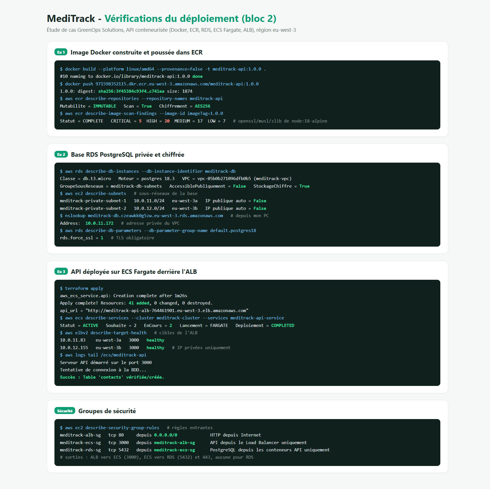

# Étude de cas GreenOps Solutions - Bloc 2

{width=6cm}

**Bachelor Administrateur système DevOps - Niveau 6**\
**Bloc de compétences : Déployer en continu une application**

**Nom et prénom du stagiaire** : Pierrick ONCHALO

**Dépôt Git du projet** : <https://github.com/Jhanemba64/greenops-meditrack-bloc2>

---

Organisation du dépôt :

| Dossier / fichier | Contenu |
|---|---|
| `api-backend/` | Les 3 fichiers fournis (`package.json`, `Dockerfile`, `index.js`) et un `.dockerignore` |
| `terraform/` | L'infrastructure : réseau, ECR, RDS, ECS, ALB, IAM, ainsi que S3 et CloudFront repris du bloc 1 |
| `docker-compose.test.yml` | L'environnement de test local (exercice 3) |
| `aws-iam/` | La politique IAM de l'utilisateur de déploiement |
| `site/` | Le site statique MediTrack Online (bloc 1) |
| `captures/` | Les captures de ce compte rendu, et dans `sources/` le schéma et les pages de preuves en HTML |

---

## Exercice 1 - Gestion et stockage de l'image de l'API

> **Consigne :** préparer l'artefact logiciel (l'image Docker) de l'API pour qu'il soit stocké et disponible pour un déploiement sécurisé sur AWS.
>
> 1. Construire l'image Docker de l'API (avec le Dockerfile fourni dans `api-backend/`)
> 2. Créer un dépôt privé sur AWS ECR (Elastic Container Registry)
> 3. Pousser l'image Docker locale vers ce dépôt ECR
>
> **À rendre :** une capture du dépôt ECR montrant l'image poussée avec son tag, et un schéma d'architecture incluant tous les composants.

### Réponse

**1) Les fichiers de l'API**

Dans `api-backend/`, j'ai repris les 3 fichiers de l'énoncé sans les modifier : `package.json` (dépendances `express` et `pg`), `Dockerfile` et `index.js`. J'ai seulement ajouté un `.dockerignore` pour qu'un éventuel dossier `node_modules` local ne parte pas dans l'image.

L'API expose trois routes :

| Route | Rôle |
|---|---|
| `GET /` | Répond « MediTrack API is running », utilisée aussi comme contrôle de santé |
| `POST /contact` | Enregistre un contact (nom, email, message) dans la base |
| `GET /contacts` | Renvoie les contacts enregistrés |

**2) Construction de l'image**

```bash
cd api-backend
docker build --platform linux/amd64 --provenance=false -t meditrack-api:1.0.0 .
```

Le tag `1.0.0` correspond à la version du `package.json`. J'ai précisé `--platform linux/amd64` pour avoir la même architecture que Fargate (x86_64). L'option `--provenance=false` évite que Docker Desktop ajoute une attestation à l'image : sans elle, une deuxième entrée sans tag apparaît dans ECR.

L'image fait 200 Mo en local et 47,9 Mo une fois compressée dans ECR.

**3) Création du dépôt ECR**

Le dépôt `meditrack-api` est créé par Terraform (`terraform/ecr.tf`) avec les réglages suivants :

| Réglage | Valeur | Intérêt |
|---|---|---|
| Visibilité | Privé | Seul le compte AWS du projet peut lire et écrire |
| Mutabilité des tags | `IMMUTABLE` | Une version publiée (`1.0.0`) ne peut pas être remplacée par une autre image |
| Analyse | `scan_on_push` | Recherche de vulnérabilités à chaque envoi |
| Chiffrement | AES-256 | Images chiffrées au repos |
| Cycle de vie | 10 images max | Les plus anciennes sont supprimées automatiquement |

```bash
terraform apply -target=aws_ecr_repository.api -target=aws_ecr_lifecycle_policy.api
# Apply complete! Resources: 2 added
```

J'ai utilisé `-target` parce que le dépôt doit exister avant le reste : ECS ne peut pas démarrer un conteneur dont l'image n'a pas encore été poussée. L'ordre est donc : dépôt, envoi de l'image, puis le reste de l'infrastructure (exercice 3).

**4) Envoi de l'image**

```bash
# connexion de Docker au dépôt (jeton valable 12 h)
aws ecr get-login-password --region eu-west-3 --profile meditrack | \
  docker login --username AWS --password-stdin 971598352115.dkr.ecr.eu-west-3.amazonaws.com
# Login Succeeded

docker tag  meditrack-api:1.0.0 971598352115.dkr.ecr.eu-west-3.amazonaws.com/meditrack-api:1.0.0
docker push 971598352115.dkr.ecr.eu-west-3.amazonaws.com/meditrack-api:1.0.0
# 1.0.0: digest: sha256:3f45384c93f4...c741ea size: 1874
```

**Capture : le dépôt ECR avec l'image `1.0.0`**

{width=16cm}

**Résultat de l'analyse de vulnérabilités**

L'analyse ECR remonte 5 vulnérabilités critiques et 20 élevées. Elles concernent toutes des paquets système de l'image de base `node:18-alpine` (`openssl`, `musl`, `zlib`), pas le code de l'API. Node.js 18 n'est plus maintenu depuis avril 2025 et son image ne reçoit plus de correctifs.

Je n'ai pas modifié le Dockerfile puisqu'il est fourni par l'énoncé. Pour une vraie mise en production, je publierais une version `1.1.0` basée sur `node:22-alpine` et je vérifierais le résultat de l'analyse avant de la déployer.

**Schéma d'architecture**

{width=17cm}

Les flux représentés :

- le visiteur du site passe par CloudFront puis S3, comme au bloc 1 ;
- les requêtes vers l'API arrivent par la passerelle Internet sur le Load Balancer, qui est le seul point d'entrée public ;
- l'ALB répartit les requêtes entre deux conteneurs Fargate, un par zone de disponibilité, qui se connectent à la base RDS sur le port 5432 en TLS ;
- les conteneurs sont dans des sous-réseaux privés. Ils passent par la NAT Gateway pour récupérer leur image dans ECR, lire le mot de passe dans Secrets Manager et envoyer leurs logs à CloudWatch. La NAT ne permet que les connexions sortantes ;
- depuis mon poste, je pousse l'image dans ECR et je crée l'infrastructure avec Terraform.

**Bilan :** l'image est construite, stockée dans un dépôt ECR privé (tags immuables, analyse, chiffrement), et le schéma d'architecture est réalisé.

---

## Exercice 2 - Provisionnement de la base de données

> **Consigne :** créer une base de données PostgreSQL relationnelle, managée et sécurisée pour l'API. La contrainte principale est qu'elle ne doit jamais être accessible depuis Internet.
>
> 1. Lancer une instance de base de données PostgreSQL via AWS RDS (type db.t3.micro)
> 2. La configurer pour qu'elle s'exécute dans votre VPC (créé dans le Bloc 1)
> 3. S'assurer qu'elle est placée dans vos sous-réseaux privés et que l'option « Publicly accessible » est sur « No »
>
> **À rendre :** une capture de l'onglet « Connectivity & security » de l'instance RDS, montrant qu'elle est dans le bon VPC et non accessible publiquement.

### Réponse

**1) Sous-réseaux privés dans le VPC du bloc 1**

Le VPC du bloc 1 (`meditrack-vpc`, `10.0.0.0/16`) ne contenait qu'un sous-réseau public. RDS demande un groupe de sous-réseaux sur au moins deux zones, et la base doit rester privée. J'ai donc complété `terraform/network.tf` :

| Sous-réseau | Plage | Zone | Contenu |
|---|---|---|---|
| public 1 | `10.0.1.0/24` | eu-west-3a | Load Balancer, NAT Gateway |
| public 2 | `10.0.2.0/24` | eu-west-3b | Load Balancer |
| privé 1 | `10.0.11.0/24` | eu-west-3a | Conteneur API n°1, base RDS |
| privé 2 | `10.0.12.0/24` | eu-west-3b | Conteneur API n°2 |

Les sous-réseaux privés n'attribuent pas d'IP publique et leur table de routage ne passe pas par la passerelle Internet. Leur seule sortie est la NAT Gateway.

**2) Instance PostgreSQL**

La base est décrite dans `terraform/rds.tf` :

| Réglage | Valeur |
|---|---|
| Moteur | PostgreSQL 18.3 |
| Classe | db.t3.micro |
| Réseau | VPC `meditrack-vpc`, groupe de sous-réseaux `meditrack-db-subnets` (les deux sous-réseaux privés) |
| Accès public | Non (`publicly_accessible = false`) |
| Groupe de sécurité | `meditrack-rds-sg` : port 5432 ouvert uniquement aux conteneurs de l'API |
| Stockage | 20 Go gp3, chiffré |
| Mot de passe | Généré par AWS et stocké dans Secrets Manager |

Avec `manage_master_user_password = true`, je ne choisis pas le mot de passe : RDS le génère et le stocke dans Secrets Manager. Il n'apparaît ni dans le code ni dans Terraform. Les conteneurs le récupèrent au démarrage (exercice 3).

Le groupe de paramètres par défaut de PostgreSQL 18 impose aussi `rds.force_ssl = 1` : la base refuse les connexions non chiffrées.

```bash
terraform apply -target=aws_db_instance.main
# crée le VPC, les sous-réseaux privés, le groupe de sous-réseaux, le groupe de sécurité et la base
```

**Erreur rencontrée**

Le premier `apply` a échoué :

```text
FreeTierRestrictionError: The specified backup retention period exceeds the maximum
available to free tier customers.
```

Le compte AWS utilisé est sur le plan gratuit, qui limite la durée de conservation des sauvegardes automatiques. J'avais mis 7 jours. Je suis passé à 1 jour (`backup_retention_period = 1`) et la création est passée. Sur un compte de production, je garderais au moins 7 jours.

**Captures : l'instance RDS**

Récapitulatif de l'instance (disponible, db.t3.micro, PostgreSQL) :

{width=16cm}

Onglet « Connectivité et sécurité » : VPC `meditrack-vpc`, les deux sous-réseaux privés, et « Accessible publiquement : Non » :

{width=16cm}

**Vérification depuis mon poste**

```bash
nslookup meditrack-db.czeawkk0g5zw.eu-west-3.rds.amazonaws.com
# Address: 10.0.11.172
```

Depuis Internet, le nom DNS de la base renvoie une adresse privée du VPC. Elle n'est donc pas joignable de l'extérieur.

**Bilan :** la base PostgreSQL est dans le VPC du bloc 1, sur les sous-réseaux privés, non accessible publiquement, chiffrée, et son mot de passe est géré par Secrets Manager.

---

## Exercice 3 - Déploiement de l'API sur ECS

> **Consigne :** mettre en service l'API en utilisant une architecture conteneurisée (Fargate) et l'exposer au public de manière fiable via un Application Load Balancer (ALB).
>
> 1. Créer un Cluster ECS (type « Networking only » pour Fargate)
> 2. Créer une Définition de Tâche qui utilise l'image ECR (exercice 1) et injecte les variables de la BDD (exercice 2) : `DB_HOST`, `DB_USER`, `DB_NAME`, `DB_PASSWORD`
> 3. Créer un Service pour exécuter cette tâche, avec un ALB public (sous-réseaux publics) qui cible le service (sous-réseaux privés)
>
> **À rendre :** une capture du Service ECS au statut ACTIVE et une capture d'un test fonctionnel (Postman ou cURL) montrant un POST et un GET réussis sur l'URL de l'ALB.

### Réponse

**1) Environnement de test local**

Avant de déployer sur AWS, j'ai testé l'image sur mon poste avec `docker-compose.test.yml`. Il lance la même image que celle poussée dans ECR, avec une base PostgreSQL 18 temporaire et les mêmes variables d'environnement qu'en production.

```bash
docker compose -f docker-compose.test.yml up -d
# api  meditrack-api:1.0.0   Up
# db   postgres:18-alpine    Up (healthy)

curl -X POST http://localhost:3000/contact -H "Content-Type: application/json" \
     -d '{"nom":"Test Local","email":"test@meditrack.local","message":"Test environnement local"}'
# HTTP 201 {"id":1,"nom":"Test Local",...}
curl http://localhost:3000/contacts
# HTTP 200, le contact est renvoyé
curl -X POST http://localhost:3000/contact -H "Content-Type: application/json" \
     -d '{"message":"sans nom ni email"}'
# HTTP 400, requête refusée

docker compose -f docker-compose.test.yml down -v
```

L'API démarre, crée sa table `contacts`, enregistre et relit un contact, et refuse une requête incomplète. L'environnement est supprimé avec sa base à la fin du test, sans rien laisser sur le poste ni toucher à la production.

**2) Cluster ECS**

Le cluster `meditrack-cluster` est défini dans `terraform/ecs.tf`. Il n'a aucune instance EC2 : c'est l'équivalent de l'ancien type « Networking only » de la console, réservé à Fargate.

J'ai activé Container Insights pour avoir les métriques CPU et mémoire des conteneurs dans CloudWatch. Les logs de l'API sont envoyés dans le groupe `/ecs/meditrack-api`, conservés 7 jours.

**3) Définition de tâche**

La définition de tâche `meditrack-api` tourne sur Fargate avec 0,25 vCPU et 512 Mo, utilise l'image `meditrack-api:1.0.0` du dépôt ECR et expose le port 3000. Variables injectées :

| Variable | Valeur | Source |
|---|---|---|
| `DB_HOST` | `meditrack-db.czeawkk0g5zw.eu-west-3.rds.amazonaws.com` | Adresse de l'instance RDS |
| `DB_USER` | `meditrack_admin` | Utilisateur principal de la base |
| `DB_NAME` | `meditrack` | Nom de la base |
| `DB_PASSWORD` | Lue dans Secrets Manager au démarrage | Secret créé par RDS |
| `PGSSLMODE` | `no-verify` | Active TLS côté client `pg` |

`DB_PASSWORD` n'a pas de valeur dans la définition de tâche : elle contient seulement l'ARN du secret (`valueFrom`). ECS lit le secret au lancement du conteneur avec le rôle d'exécution `meditrack-ecs-execution-role`, qui n'a le droit de lire que ce secret.

J'ai ajouté `PGSSLMODE` parce que la base exige TLS et que le code fourni ne configure pas de connexion chiffrée. La bibliothèque `pg` lit cette variable d'environnement standard. J'ai vérifié dans le code de `pg` 8.23 installé dans l'image que `no-verify` active bien TLS. Le certificat du serveur n'est pas vérifié, mais la connexion reste chiffrée et ne sort pas du VPC. Cela évite de modifier `index.js`.

Capture de la définition de tâche (image ECR et variables, `DB_PASSWORD` provenant de Secrets Manager) :

{width=16cm}

**4) Load Balancer et service**

- L'ALB `meditrack-api-alb` (`terraform/alb.tf`) est public, placé dans les deux sous-réseaux publics, et écoute en HTTP sur le port 80. Il transmet au groupe cible `meditrack-api-tg`, de type `ip` (obligatoire avec Fargate), sur le port 3000. Le contrôle de santé interroge `/` toutes les 15 secondes.
- Le service `meditrack-api-service` maintient deux tâches, une dans chaque sous-réseau privé, sans IP publique. Si une tâche s'arrête ou si une zone devient indisponible, l'autre continue de répondre.
- Le disjoncteur de déploiement (`deployment_circuit_breaker`) est activé avec retour arrière : si une nouvelle version ne démarre pas, ECS revient à la précédente.

**Groupes de sécurité** (`terraform/security_groups.tf`)

| Groupe | Entrée autorisée | Exigence de l'énoncé |
|---|---|---|
| `meditrack-alb-sg` (ALB) | TCP 80 depuis `0.0.0.0/0` | HTTP depuis Internet sur le Load Balancer |
| `meditrack-ecs-sg` (tâches) | TCP 3000 depuis `meditrack-alb-sg` uniquement | Port 3000 uniquement depuis le Load Balancer |
| `meditrack-rds-sg` (base) | TCP 5432 depuis `meditrack-ecs-sg` uniquement | Port 5432 uniquement depuis l'application |

L'annexe de l'énoncé parle d'« instance EC2 » pour l'application. Avec Fargate, ce rôle est tenu par les tâches ECS : j'ai donc appliqué ces règles au groupe de sécurité des tâches.

Les règles font référence à d'autres groupes de sécurité plutôt qu'à des adresses IP, car les tâches changent d'IP à chaque redémarrage. Les sorties sont aussi limitées : l'ALB ne peut joindre que les tâches sur le port 3000. Les tâches ne peuvent joindre que la base sur le port 5432 et HTTPS (443) pour ECR, Secrets Manager et CloudWatch. La base n'a aucune règle de sortie.

**5) Déploiement**

```bash
terraform apply
# Plan: 41 to add, 0 to change, 0 to destroy.
# aws_ecs_service.api: Creation complete after 1m26s
# Apply complete! Resources: 41 added, 0 changed, 0 destroyed.
#
# api_url        = "http://meditrack-api-alb-764461901.eu-west-3.elb.amazonaws.com"
# cloudfront_url = "https://d3n07gdtflzelp.cloudfront.net"
```

Le service est déclaré avec `wait_for_steady_state = true`. Terraform attend donc que les deux tâches soient saines derrière l'ALB avant de terminer. Si l'API ne démarrait pas, l'`apply` échouerait.

Les logs CloudWatch de chaque tâche montrent la connexion à la base :

```text
Serveur API démarré sur le port 3000
Tentative de connexion à la BDD...
Succès : Table 'contacts' vérifiée/créée.
```

**Capture : le service ECS au statut ACTIVE**

Statut actif, 2 tâches en cours sur 2 souhaitées, déploiement réussi et 2 cibles saines sur le Load Balancer :

{width=16cm}

**Capture : test cURL sur l'URL de l'ALB**

Un POST (`201 Created`), un GET (`200 OK`) qui renvoie les contacts enregistrés dans RDS, et une requête incomplète refusée (`400`) :

{width=12.5cm}

**Bilan :** l'API a été testée en local puis déployée sur ECS Fargate (deux tâches sur deux zones) derrière un ALB public. Les variables de la base sont injectées, le mot de passe venant de Secrets Manager. Le POST et le GET fonctionnent sur l'URL de l'ALB.

---

## Synthèse

**Mesures de sécurité et vérifications**

| Mesure | Ressource | Vérification |
|---|---|---|
| Base non exposée | RDS | « Accessible publiquement : Non », sous-réseaux privés, IP privée `10.0.11.172` |
| Tâches non exposées | ECS | IP privées `10.0.11.83` et `10.0.12.155`, pas d'IP publique |
| Un seul point d'entrée | ALB | Seul le port 80 de l'ALB est ouvert sur Internet |
| Flux filtrés entre les couches | Groupes de sécurité | ALB vers tâches sur 3000, tâches vers base sur 5432 |
| Mot de passe non stocké en clair | Secrets Manager | `DB_PASSWORD` en `valueFrom` dans la définition de tâche |
| Chiffrement en transit vers la base | RDS, API | `rds.force_ssl = 1` et connexion réussie avec `PGSSLMODE` |
| Chiffrement au repos | RDS, ECR, S3 | Stockage RDS chiffré, ECR et S3 en AES-256 |
| Contrôle de l'image | ECR | Tags immuables et analyse à chaque envoi |
| Moindre privilège | IAM | Utilisateur de déploiement limité aux services du projet, rôle ECS limité à un secret |
| Localisation des données | Toute l'infrastructure | Région Paris (`eu-west-3`), pour le RGPD et l'HDS |

**Sorties de commandes**

{width=16cm}

**Compétences**

| Compétence | Travail réalisé |
|---|---|
| CP7 - Gérer des conteneurs | Image `meditrack-api:1.0.0` construite, analysée et stockée dans un dépôt ECR privé |
| CP6 - Gérer le stockage des données | Base PostgreSQL RDS privée et chiffrée, mot de passe dans Secrets Manager |
| CP5 - Préparer un environnement de test | Environnement Docker Compose (API et PostgreSQL) utilisé avant la mise en production |
| CP8 - Automatiser la mise en production | Déploiement Terraform de 41 ressources, service ECS actif, API accessible via l'ALB |

**Améliorations possibles**

- Passer l'API en HTTPS, avec un certificat ACM sur l'ALB (ce qui suppose un nom de domaine) ou en la publiant derrière CloudFront.
- Corriger les vulnérabilités de l'image en passant à `node:22-alpine` (version `1.1.0`), et ne déployer qu'après une analyse propre.
- Mettre en place un pipeline CI/CD (GitHub Actions) qui construit, analyse et pousse l'image, puis met à jour le service ECS à chaque modification du code.
- Passer RDS en Multi-AZ, activer la protection contre la suppression et garder 7 jours de sauvegardes (hors plan gratuit).
- Vérifier le certificat de la base (`verify-full`) en ajoutant le certificat RDS dans l'image.

---

## Coûts et suppression

L'infrastructure est toujours en ligne. Les postes les plus chers sont la NAT Gateway, le Load Balancer, l'instance RDS et les deux tâches Fargate. D'après les tarifs publics de la région Paris, j'estime le total à environ 0,14 $ par heure, soit environ 3 $ par jour. Une seule commande supprime l'ensemble, y compris le dépôt ECR et son image :

```bash
cd terraform
terraform destroy
```

Pour tout recréer, il suffit de reprendre l'ordre de ce compte rendu : `terraform apply -target=aws_ecr_repository.api`, `docker push` de l'image, puis `terraform apply`.
