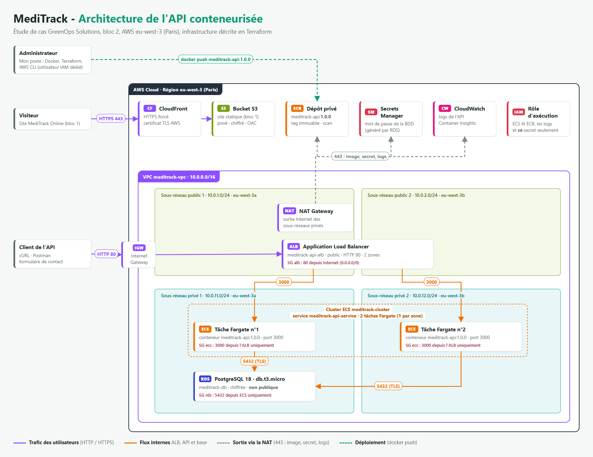

# MediTrack - déploiement de l'API sur AWS (GreenOps Solutions, bloc 2)

Étude de cas du Bachelor Administrateur système DevOps (ISCOD), bloc « Déployer en continu une application ».

L'API de contact de MediTrack est conteneurisée avec Docker, stockée dans un dépôt ECR privé et exécutée sur ECS Fargate derrière un Application Load Balancer. Les données sont stockées dans une base RDS PostgreSQL placée dans des sous-réseaux privés. Toute l'infrastructure est décrite en Terraform, y compris le site statique du bloc 1 (S3 et CloudFront).

Le détail de la démarche, les captures et les vérifications sont dans le compte rendu : [Compte-rendu_EDC-GreenOps-Bloc2.md](Compte-rendu_EDC-GreenOps-Bloc2.md) (également disponible en [PDF](Compte-rendu_EDC-GreenOps-Bloc2.pdf)).



## Contenu

| Dossier / fichier | Contenu |
|---|---|
| `api-backend/` | Code de l'API fourni par l'énoncé (`package.json`, `Dockerfile`, `index.js`) |
| `terraform/` | Réseau (VPC, sous-réseaux, NAT), ECR, RDS, ECS, ALB, IAM, S3, CloudFront |
| `docker-compose.test.yml` | Environnement de test local : l'API et une base PostgreSQL temporaire |
| `aws-iam/` | Politique IAM de l'utilisateur de déploiement |
| `site/` | Site statique MediTrack Online (bloc 1) |
| `captures/` | Captures du compte rendu ; `sources/` contient le schéma et les pages de preuves en HTML |

## Prérequis

- AWS CLI avec un profil `meditrack` (utilisateur IAM de déploiement), région `eu-west-3`
- Terraform 1.5 ou plus
- Docker

## Déploiement

```bash
# Construction et test local de l'image
docker build --platform linux/amd64 --provenance=false -t meditrack-api:1.0.0 api-backend
docker compose -f docker-compose.test.yml up -d
docker compose -f docker-compose.test.yml down -v

# Dépôt ECR, puis envoi de l'image
cd terraform
terraform init
terraform apply -target=aws_ecr_repository.api -target=aws_ecr_lifecycle_policy.api
aws ecr get-login-password --region eu-west-3 --profile meditrack | \
  docker login --username AWS --password-stdin <compte>.dkr.ecr.eu-west-3.amazonaws.com
docker tag  meditrack-api:1.0.0 <compte>.dkr.ecr.eu-west-3.amazonaws.com/meditrack-api:1.0.0
docker push <compte>.dkr.ecr.eu-west-3.amazonaws.com/meditrack-api:1.0.0

# Reste de l'infrastructure (réseau, RDS, ECS, ALB, site)
terraform apply
terraform output api_url
```

Test de l'API :

```bash
curl -X POST <api_url>/contact -H "Content-Type: application/json" \
     -d '{"nom":"Test","email":"test@example.com","message":"Bonjour"}'
curl <api_url>/contacts
```

## Suppression

```bash
cd terraform
terraform destroy
```

La commande supprime toutes les ressources, dépôt ECR compris.

## Sécurité

- Base RDS et tâches ECS dans des sous-réseaux privés, sans IP publique
- Seul le port 80 de l'ALB est exposé à Internet
- Groupes de sécurité en chaîne : ALB vers ECS sur 3000, ECS vers RDS sur 5432
- Mot de passe de la base généré par RDS, stocké dans Secrets Manager et injecté au démarrage des tâches
- Chiffrement au repos (RDS, ECR, S3) et connexion TLS vers la base (`rds.force_ssl = 1`)
- Dépôt ECR privé, tags immuables, analyse des vulnérabilités à chaque envoi
- Ressources hébergées dans la région Paris (`eu-west-3`)
